  <a href="https://heystone.site/">
    <picture>
      <source media="(prefers-color-scheme: dark)" srcset="./assets/hero-dark.svg" />
      <source media="(prefers-color-scheme: light)" srcset="./assets/hero-light.svg" />
      
    </picture>
  </a>

  <a href="https://heystone.site/"><strong>个人网站</strong></a> ·
  <a href="https://blog.heystone.site/"><strong>独立博客</strong></a> ·
  <a href="https://youdang.heystone.site/"><strong>游荡集</strong></a> ·
  <a href="https://read.heystone.site/"><strong>Research Edition</strong></a> ·
  <a href="https://t.me/ericlibro">Telegram</a> ·
  <a href="mailto:zhuxinyao99@gmail.com">Email</a>

 

Hi，我是 **朱鑫垚（stone / 石头）**。在北外读国际商务，虽非科班，但喜欢看书、听播客，也爱把生活和工作里遇到的真问题，拉着 AI 敲敲打打做成能用、耐看的小作品。

这里像我敞着门的书桌——挑一件顺眼的翻翻看，有共鸣处随时来聊聊。

### Now · 最近在折腾

- 🧭 **AI 工作流与工程纪律**：打磨私域商业情报助手（GraphRAG），把从模糊想法到可运行版本的 0→1 路径整理成可复用的 Agent 路由器
- 🏝️ **可玩的知识世界**：持续扩展 [Product Quest](https://github.com/nuts-and-bytes/Product-quest) 的四块 3D 开放大陆与**星潮 AI 博物馆**
- ✍️ **把过程写下来**：在 [stone 博客](https://blog.heystone.site/) 记录读书笔记、AI 实战踩坑和真实可用的起步包

---

### 书架与工作台 · Selected Works

| 作品 | 它是什么 | 入口 |
| :--- | :--- | :---: |
| [**Product Quest · 产品经理大冒险**](https://github.com/nuts-and-bytes/Product-quest) | 四块 3D 开放大陆（产品 / AI / 增长 / 设计）+ 星潮 AI 博物馆，用现场调查与实验代替背框架 | [登岛试玩 ↗](https://nuts-and-bytes.github.io/Product-quest/) |
| [**铁证 IRONPROOF**](https://github.com/nuts-and-bytes/tiezheng) | 本地优先的训练、营养与体重 PWA，攒久了能看趋势，也能生成一张给自己打气的训练海报 | [打开应用 ↗](https://tiezheng.pages.dev/) |
| [**Zero-to-One Product**](https://github.com/nuts-and-bytes/zero-to-one-product) | 把产品发现与工程执行接成一条固定路线的 Codex 0→1 流程路由器 | [交互文档 ↗](https://nuts-and-bytes.github.io/zero-to-one-product/) |
| [**stone · 个人网站**](https://github.com/nuts-and-bytes/portfolio) | 作品、文章与 Moments 的统一入口，带可翻看的照片叠与桌面小挂件 | [heystone.site ↗](https://heystone.site/) |
| [**stone · 独立博客**](https://github.com/nuts-and-bytes/ai-songshu-garden) | 读书笔记、个人随笔与 AI 实践记录，配细线橙色插画与互动角色「小橙」 | [blog.heystone.site ↗](https://blog.heystone.site/) |
| [**Daily Tree · 记忆森林**](https://github.com/nuts-and-bytes/daily-tree) | 每天留下一句话与一张图，屏幕里的小树会跟着你的记录抽枝长叶 | [种一棵树 ↗](https://nuts-and-bytes.github.io/daily-tree/app/) |
| [**Word Universe · 词义星系**](https://github.com/nuts-and-bytes/word-universe) | 把学过的词放进可漫游的 D3 星空，支持可选语义向量按词义聚类 | [漫游星系 ↗](https://nuts-and-bytes.github.io/word-universe/app/) |
| **游荡集 & Research Edition** | 把播客长谈读成一本书；去掉快讯杂音的沉浸式 AI 产业长文阅读室 | [游荡集 ↗](https://youdang.heystone.site/) · [阅读室 ↗](https://read.heystone.site/) |

---

<strong>🪨 打开书桌抽屉 · 关于我、工具箱与联系方式</strong>

 

- **常顺手用的技术**：TypeScript / React / Vite / Astro / Tailwind CSS / Three.js & Canvas / D3.js / Python / Cloudflare Pages & Vercel
- **常用来搭工作流的**：Codex / Claude Code / Obsidian / GraphRAG
- **欢迎随时打招呼**：
  - 也在折腾 AI 工作流、知识库或独立小工具，想交流切磋；
  - 最近读到了后劲很长的书或播客，想找人分享；
  - 试玩了上面的作品有建议，或者单纯想说句「嗨」。
- **找到我**：[zhuxinyao99@gmail.com](mailto:zhuxinyao99@gmail.com) · [Telegram @ericlibro](https://t.me/ericlibro) · [heystone.site](https://heystone.site/)

  <i>"把书房门虚掩着留盏灯——愿这些作品与文字，能替我遇上同频的朋友。"</i>

