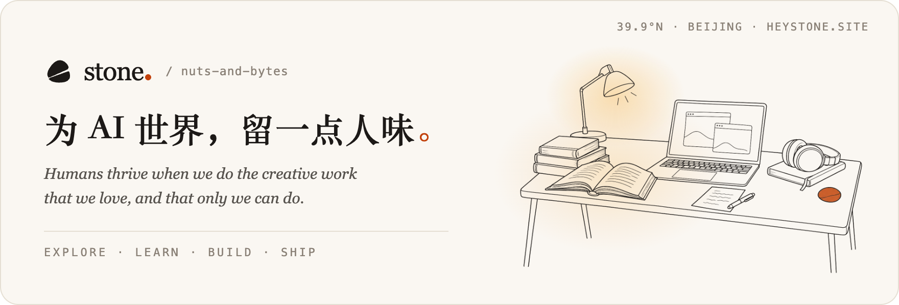
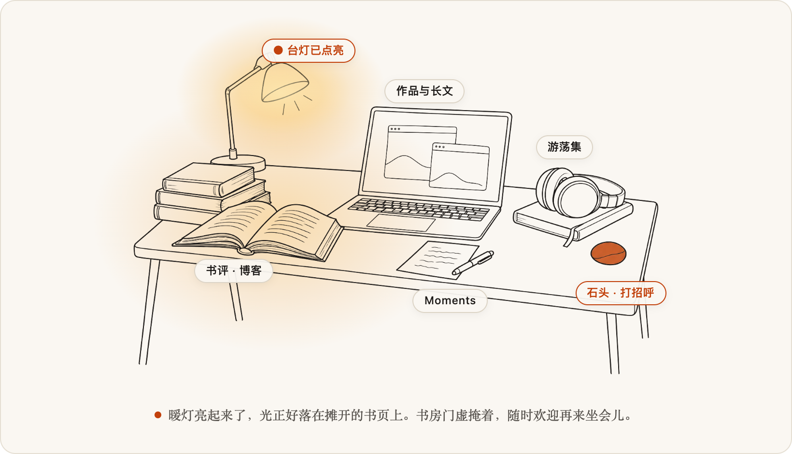

  <a href="https://heystone.site/#stone-corner">
    <picture>
      <source media="(prefers-color-scheme: dark)" srcset="./assets/hero-dark.png" />
      <source media="(prefers-color-scheme: light)" srcset="./assets/hero-light.png" />
      
    </picture>
  </a>

  <a href="https://heystone.site/"><strong>个人网站</strong></a> ·
  <a href="https://blog.heystone.site/"><strong>独立博客</strong></a> ·
  <a href="https://read.heystone.site/"><strong>Research Edition</strong></a> ·
  <a href="https://youdang.heystone.site/"><strong>游荡集</strong></a> ·
  <a href="https://heystone.site/moments">Moments</a> ·
  <a href="https://t.me/ericlibro">Telegram</a> ·
  <a href="mailto:zhuxinyao99@gmail.com">Email</a>

 

Hi，我是 **xinyao（stone / 石头）**。在北外读国际商务，虽非科班，但喜欢看书、听播客，也爱把生活和工作里遇到的真问题，拉着 AI 敲敲打打做成能用、耐看的小作品。

这里像我敞着门的书桌——挑一件顺眼的翻翻看，有共鸣处随时来聊聊。

### 🪑 Stone 的一角 · 点一点桌上的物件

<strong>💡 点亮书桌台灯</strong> — 看看这张书桌上藏着什么

 

  <a href="https://heystone.site/#stone-corner">
    <picture>
      <source media="(prefers-color-scheme: dark)" srcset="./assets/desk-lamp-on-dark.png" />
      <source media="(prefers-color-scheme: light)" srcset="./assets/desk-lamp-on-light.png" />
      
    </picture>
  </a>

  <a href="https://blog.heystone.site/categories/%E4%B9%A6%E8%AF%84.html">📖 翻开书评 ↗</a> ·
  <a href="https://heystone.site/#cases">💻 逛逛作品 ↗</a> ·
  <a href="https://read.heystone.site/">🗞️ 读 AI 长文 ↗</a> ·
  <a href="https://youdang.heystone.site/">🎧 戴上耳机听游荡集 ↗</a> ·
  <a href="https://heystone.site/moments">📝 翻看 Moments ↗</a> ·
  <a href="https://heystone.site/#stone-corner">💡 去原站亲手开关台灯 ↗</a>

<strong>🪨 戳一下桌角那块陶土橙小石头</strong> — 打个招呼，或留张纸条

 

> 「你好呀，我是石头。谢谢你一路逛到这里，愿你今天也有一个小小的发现，常来玩。」

如果你也在折腾 AI 工作流、最近读到了后劲很长的书或播客，或者试玩了下面的作品有想法：

- 📝 [**在我的 GitHub 书桌上留张纸条 ↗**](https://github.com/nuts-and-bytes/nuts-and-bytes/issues/new?template=say-hi.yml)（打开书桌留言卡，随手打个招呼）
- ✉️ 写封信给我：[zhuxinyao99@gmail.com](mailto:zhuxinyao99@gmail.com) · Telegram：[@ericlibro](https://t.me/ericlibro)

<strong>🎲 不知道先翻哪一件？按此刻的心情抽一张</strong>

 

| 如果你此刻想…… | 推荐先打开 |
| :--- | :--- |
| 玩点有故事的 3D 互动，顺便逛逛 AI 博物馆 | [**Product Quest · 产品经理大冒险 ↗**](https://nuts-and-bytes.github.io/Product-quest/) |
| 静下心一次读完一篇高质量 AI 产业长报告 | [**Research Edition · AI 产业长文解读 ↗**](https://read.heystone.site/) |
| 看真实踩坑笔记、读书回声和拿走就能用的 AI Skill | [**stone · 独立博客 ↗**](https://blog.heystone.site/) |
| 把喜欢的播客长谈当成一本书慢慢翻阅 | [**游荡集 · 播客精读专题站 ↗**](https://youdang.heystone.site/) |
| 抄一套有纪律的 Codex 0→1 工程工作流 | [**Zero-to-One Product ↗**](https://nuts-and-bytes.github.io/zero-to-one-product/) |

---

### Now · 最近在折腾

- 🧭 **AI 工作流与工程纪律**：打磨私域商业情报助手（GraphRAG），把从模糊想法到可运行版本的 0→1 路径整理成可复用的 Agent 路由器
- 🏝️ **可玩的知识世界**：持续扩展 [Product Quest](https://github.com/nuts-and-bytes/Product-quest) 的四块 3D 开放大陆与**星潮 AI 博物馆**
- ✍️ **深度阅读与写作**：在 [stone 博客](https://blog.heystone.site/) 写读书与 AI 实战，在 [Research Edition](https://read.heystone.site/) 沉淀 AI 产业长文导读

---

### ✍️ 最近写的三篇 · Latest from [blog.heystone.site](https://blog.heystone.site/)

<!-- BLOG-POST-LIST:START -->
- `2026-11-17` · [我让 AI 把 X 网页做成了桌面应用 ↗](https://blog.heystone.site/posts/pake-x-desktop-with-ai)
- `2026-11-13` · [wait-what：这段没懂，重讲一下 ↗](https://blog.heystone.site/posts/wait-what-explain-again)
- `2026-10-28` · [《一句顶一万句》读后感 ↗](https://blog.heystone.site/posts/%E4%B8%80%E5%8F%A5%E9%A1%B6%E4%B8%80%E4%B8%87%E5%8F%A5-%E8%AF%BB%E5%90%8E%E6%84%9F)
<!-- BLOG-POST-LIST:END -->

---

### 📚 独立站点与阅读阵地 · Sites & Reading

| 站点 | 定位与内容 | 入口 |
| :--- | :--- | :---: |
| [**stone · 个人博客**](https://blog.heystone.site/) | **静水流深**：20 篇读书笔记、个人随笔与 AI 实战记录（含 Obsidian 第二大脑、`wait-what` 小橙互动与可下载 Skill）· [源码](https://github.com/nuts-and-bytes/ai-songshu-garden) | [阅读博客 ↗](https://blog.heystone.site/) |
| [**Research Edition · AI 长文解读**](https://read.heystone.site/) | **沉浸式 AI 深度阅读室**：去掉碎片快讯杂音，精选投资与研究机构原始 AI 产业长文与报告，标明出处与证据边界，配中文脉络导读 | [走进阅读室 ↗](https://read.heystone.site/) |
| [**stone · 个人网站**](https://heystone.site/) | **敞着门的书桌总入口**：代表作品页内体验、微动画工具箱、Moments 动态流与可点亮台灯的「Stone 的一角」· [源码](https://github.com/nuts-and-bytes/portfolio) | [访问网站 ↗](https://heystone.site/) |
| [**游荡集 · 播客精读站**](https://youdang.heystone.site/) | **把播客读成一本书**：许知远《游荡集》非官方精读小站，含游荡地图、人物书影音索引与随时回溯原声 | [翻开游荡集 ↗](https://youdang.heystone.site/) |

---

### 🛠️ 互动作品与效率工具 · Projects & Tools

| 作品 | 它是什么 | 入口 |
| :--- | :--- | :---: |
| [**Product Quest · 产品经理大冒险**](https://github.com/nuts-and-bytes/Product-quest) | 四块 3D 开放大陆（产品 / AI / 增长 / 设计）+ 星潮 AI 博物馆，用现场调查与实验代替背框架 | [登岛试玩 ↗](https://nuts-and-bytes.github.io/Product-quest/) |
| [**铁证 IRONPROOF**](https://github.com/nuts-and-bytes/tiezheng) | 本地优先的训练、营养与体重 PWA，攒久了能看趋势，也能生成一张给自己打气的训练海报 | [打开应用 ↗](https://tiezheng.pages.dev/) |
| [**Zero-to-One Product**](https://github.com/nuts-and-bytes/zero-to-one-product) | 把产品发现与工程执行接成一条固定路线的 Codex 0→1 流程路由器 | [交互文档 ↗](https://nuts-and-bytes.github.io/zero-to-one-product/) |
| [**Daily Tree · 记忆森林**](https://github.com/nuts-and-bytes/daily-tree) | 每天留下一句话与一张图，屏幕里的小树会跟着你的记录抽枝长叶 | [种一棵树 ↗](https://nuts-and-bytes.github.io/daily-tree/app/) |
| [**Word Universe · 词义星系**](https://github.com/nuts-and-bytes/word-universe) | 把学过的词放进可漫游的 D3 星空，支持可选语义向量按词义聚类 | [漫游星系 ↗](https://nuts-and-bytes.github.io/word-universe/app/) |

---

<strong>🧰 打开书桌抽屉 · 常顺手用的工具箱与技术栈</strong>

 

- **前端与交互**：TypeScript / React / Vite / Astro / Tailwind CSS / Three.js & Canvas / D3.js
- **AI 与工作流**：Codex / Claude Code / Obsidian / GraphRAG / Python
- **部署与工程**：Cloudflare Pages / Vercel / GitHub Actions / Vitest & Playwright

  <i>"把书房门虚掩着留盏灯——愿这些作品与文字，能替我遇上同频的朋友。"</i>

